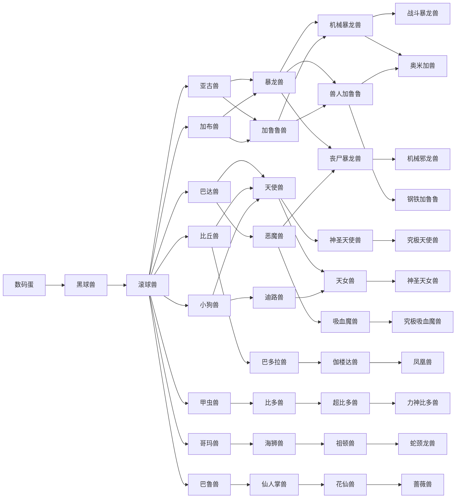

# 进化网 / Evolution network

> 从数码蛋开始，3 分钟孵化成黑球兽，8 分钟后可进化为滚球兽。
> 滚球兽有 8 条成长期分支，之后是多条交叉的完全体 / 究极体 / 超究极体路线。
> 条件参考《数码宝贝物语 时空异客》（Digimon Story: Time Stranger）的等级 / 能力值思路，
> 并额外用体重 / 胜场做本固件的分支限制；时间按分钟压缩，不是游戏内原始数值。

共 **41** 个形态、**49** 条进化边。

## 物种

| ID | 名字 | 属性 | 体重(kg) | HP | SP | ATK | DEF | INT | SPI | SPD |
| ---: | --- | --- | ---: | ---: | ---: | ---: | ---: | ---: | ---: | ---: |
| 0 | 数码蛋 | 未知 | 1 | 10 | 5 | 1 | 1 | 1 | 1 | 1 |
| 1 | 黑球兽 | 自由 | 5 | 45 | 10 | 8 | 6 | 4 | 4 | 6 |
| 2 | 滚球兽 | 自由 | 10 | 70 | 18 | 16 | 12 | 8 | 8 | 14 |
| 3 | 亚古兽 | 病毒 | 35 | 120 | 38 | 34 | 22 | 14 | 16 | 26 |
| 4 | 加布兽 | 数据 | 40 | 112 | 36 | 30 | 26 | 16 | 18 | 24 |
| 5 | 巴达兽 | 疫苗 | 14 | 95 | 42 | 20 | 16 | 22 | 28 | 28 |
| 6 | 比丘兽 | 疫苗 | 18 | 100 | 44 | 22 | 18 | 24 | 30 | 30 |
| 7 | 甲虫兽 | 疫苗 | 30 | 110 | 40 | 24 | 26 | 28 | 22 | 24 |
| 8 | 哥玛兽 | 疫苗 | 25 | 130 | 38 | 26 | 24 | 18 | 20 | 22 |
| 9 | 巴鲁兽 | 数据 | 20 | 105 | 42 | 22 | 20 | 26 | 26 | 24 |
| 10 | 小狗兽 | 疫苗 | 12 | 90 | 46 | 18 | 14 | 26 | 32 | 30 |
| 11 | 暴龙兽 | 病毒 | 120 | 230 | 62 | 60 | 44 | 24 | 28 | 40 |
| 12 | 加鲁鲁兽 | 数据 | 95 | 210 | 60 | 52 | 42 | 30 | 34 | 46 |
| 13 | 天使兽 | 疫苗 | 32 | 175 | 82 | 34 | 32 | 46 | 56 | 48 |
| 14 | 巴多拉兽 | 疫苗 | 45 | 185 | 80 | 40 | 34 | 40 | 50 | 50 |
| 15 | 比多兽 | 疫苗 | 110 | 220 | 74 | 48 | 52 | 50 | 40 | 38 |
| 16 | 海狮兽 | 疫苗 | 130 | 240 | 70 | 54 | 50 | 30 | 36 | 36 |
| 17 | 仙人掌兽 | 数据 | 70 | 200 | 76 | 44 | 44 | 52 | 48 | 40 |
| 18 | 迪路兽 | 疫苗 | 28 | 165 | 86 | 40 | 30 | 50 | 60 | 54 |
| 19 | 恶魔兽 | 病毒 | 80 | 220 | 70 | 80 | 50 | 40 | 50 | 60 |
| 20 | 机械暴龙兽 | 病毒 | 260 | 390 | 92 | 94 | 78 | 42 | 54 | 62 |
| 21 | 兽人加鲁鲁 | 数据 | 185 | 350 | 90 | 82 | 66 | 48 | 58 | 78 |
| 22 | 神圣天使兽 | 疫苗 | 75 | 330 | 142 | 60 | 58 | 88 | 100 | 74 |
| 23 | 伽楼达兽 | 疫苗 | 90 | 340 | 138 | 70 | 60 | 94 | 104 | 72 |
| 24 | 超比多兽 | 疫苗 | 220 | 400 | 120 | 80 | 100 | 96 | 80 | 70 |
| 25 | 祖顿兽 | 疫苗 | 280 | 430 | 110 | 100 | 96 | 60 | 70 | 64 |
| 26 | 花仙兽 | 数据 | 120 | 320 | 140 | 62 | 62 | 100 | 110 | 84 |
| 27 | 天女兽 | 疫苗 | 55 | 310 | 150 | 58 | 56 | 100 | 120 | 86 |
| 28 | 丧尸暴龙兽 | 未知 | 300 | 430 | 72 | 152 | 62 | 20 | 32 | 52 |
| 29 | 吸血魔兽 | 病毒 | 160 | 380 | 110 | 110 | 90 | 90 | 110 | 100 |
| 30 | 战斗暴龙兽 | 病毒 | 400 | 570 | 132 | 142 | 112 | 66 | 82 | 94 |
| 31 | 钢铁加鲁鲁 | 数据 | 330 | 530 | 130 | 126 | 120 | 80 | 94 | 106 |
| 32 | 究极天使兽 | 疫苗 | 155 | 490 | 205 | 94 | 90 | 134 | 152 | 102 |
| 33 | 凤凰兽 | 疫苗 | 180 | 500 | 200 | 96 | 88 | 140 | 160 | 110 |
| 34 | 力神比多兽 | 疫苗 | 380 | 600 | 180 | 130 | 150 | 130 | 120 | 110 |
| 35 | 蛇颈龙兽 | 数据 | 450 | 650 | 170 | 120 | 130 | 100 | 120 | 120 |
| 36 | 蔷薇兽 | 数据 | 220 | 520 | 200 | 110 | 110 | 150 | 160 | 130 |
| 37 | 神圣天女兽 | 疫苗 | 120 | 510 | 220 | 100 | 96 | 150 | 180 | 140 |
| 38 | 究极吸血魔兽 | 病毒 | 340 | 620 | 160 | 180 | 140 | 120 | 150 | 130 |
| 39 | 奥米加兽 | 疫苗 | 500 | 750 | 220 | 210 | 190 | 160 | 180 | 170 |
| 40 | 机械邪龙兽 | 病毒 | 420 | 650 | 170 | 180 | 160 | 120 | 140 | 120 |

## 进化边

| 从 | 到 | 条件 |
| --- | --- | --- |
| 数码蛋 | 黑球兽 | 3分钟 |
| 黑球兽 | 滚球兽 | 8分钟 |
| 滚球兽 | 亚古兽 | 15分钟 / Lv.2 / ATK≥20 / 体重≥10kg |
| 滚球兽 | 加布兽 | 15分钟 / Lv.2 / DEF≥16 / 体重≥10kg |
| 滚球兽 | 巴达兽 | 18分钟 / Lv.2 / SPI≥12 / 体重≤11kg |
| 滚球兽 | 比丘兽 | 18分钟 / Lv.2 / INT≥12 / 体重≤11kg |
| 滚球兽 | 甲虫兽 | 18分钟 / Lv.2 / INT≥14 / 体重≤12kg |
| 滚球兽 | 哥玛兽 | 18分钟 / Lv.2 / HP≥90 / 体重≥12kg |
| 滚球兽 | 巴鲁兽 | 18分钟 / Lv.2 / INT≥12 / 体重≤10kg |
| 滚球兽 | 小狗兽 | 20分钟 / Lv.2 / SPI≥14 / 体重≤10kg |
| 亚古兽 | 暴龙兽 | 45分钟 / Lv.2 / ATK≥45 / 体重≥15kg |
| 亚古兽 | 加鲁鲁兽 | 50分钟 / Lv.2 / SPD≥40 / 体重≥15kg |
| 加布兽 | 加鲁鲁兽 | 45分钟 / Lv.2 / SPD≥40 / 体重≥20kg |
| 加布兽 | 暴龙兽 | 50分钟 / Lv.2 / ATK≥45 / 体重≥20kg |
| 巴达兽 | 天使兽 | 45分钟 / Lv.2 / SPI≥35 / 体重≤25kg |
| 巴达兽 | 恶魔兽 | 45分钟 / Lv.2 / ATK≥35 |
| 比丘兽 | 巴多拉兽 | 45分钟 / Lv.2 / SPI≥30 / 体重≤25kg |
| 比丘兽 | 天使兽 | 50分钟 / Lv.2 / SPI≥35 |
| 甲虫兽 | 比多兽 | 45分钟 / Lv.2 / INT≥30 / 体重≤35kg |
| 哥玛兽 | 海狮兽 | 45分钟 / Lv.2 / HP≥180 / 体重≥25kg |
| 巴鲁兽 | 仙人掌兽 | 45分钟 / Lv.2 / INT≥28 / 体重≤25kg |
| 小狗兽 | 迪路兽 | 50分钟 / Lv.2 / SPI≥35 / 体重≤15kg |
| 小狗兽 | 天使兽 | 55分钟 / Lv.2 / SPI≥35 |
| 暴龙兽 | 机械暴龙兽 | 100分钟 / Lv.4 / ATK≥80 / 体重≥60kg |
| 暴龙兽 | 丧尸暴龙兽 | 90分钟 / Lv.3 / ATK≥100 / 体重≥50kg |
| 暴龙兽 | 兽人加鲁鲁 | 110分钟 / Lv.4 / SPD≥70 |
| 加鲁鲁兽 | 兽人加鲁鲁 | 100分钟 / Lv.4 / SPD≥80 / 体重≥50kg |
| 加鲁鲁兽 | 机械暴龙兽 | 110分钟 / Lv.4 / ATK≥80 |
| 天使兽 | 神圣天使兽 | 100分钟 / Lv.4 / SPI≥70 / 体重≤40kg |
| 天使兽 | 天女兽 | 110分钟 / Lv.4 / SPI≥80 / 体重≤40kg |
| 巴多拉兽 | 伽楼达兽 | 100分钟 / Lv.4 / SPI≥70 / 体重≤60kg |
| 比多兽 | 超比多兽 | 100分钟 / Lv.4 / INT≥70 / 体重≤60kg |
| 海狮兽 | 祖顿兽 | 100分钟 / Lv.4 / HP≥300 / 体重≥60kg |
| 仙人掌兽 | 花仙兽 | 100分钟 / Lv.4 / INT≥70 / 体重≤50kg |
| 迪路兽 | 天女兽 | 100分钟 / Lv.4 / SPI≥80 / 体重≤40kg |
| 恶魔兽 | 吸血魔兽 | 90分钟 / Lv.4 / ATK≥90 / 体重≥40kg |
| 恶魔兽 | 丧尸暴龙兽 | 100分钟 / Lv.4 / ATK≥100 |
| 机械暴龙兽 | 战斗暴龙兽 | 200分钟 / Lv.7 / ATK≥150 / 体重≥150kg / 胜场≥3 |
| 机械暴龙兽 | 奥米加兽 | 260分钟 / Lv.10 / ATK≥160 / DEF≥140 / 胜场≥8 |
| 兽人加鲁鲁 | 钢铁加鲁鲁 | 200分钟 / Lv.7 / SPD≥130 / 体重≥120kg / 胜场≥3 |
| 兽人加鲁鲁 | 奥米加兽 | 260分钟 / Lv.10 / ATK≥160 / DEF≥140 / 胜场≥8 |
| 神圣天使兽 | 究极天使兽 | 200分钟 / Lv.7 / SPI≥140 / 胜场≥4 |
| 伽楼达兽 | 凤凰兽 | 200分钟 / Lv.7 / SPI≥140 / 胜场≥4 |
| 超比多兽 | 力神比多兽 | 200分钟 / Lv.7 / INT≥140 / 胜场≥4 |
| 祖顿兽 | 蛇颈龙兽 | 200分钟 / Lv.7 / HP≥500 / 胜场≥4 |
| 花仙兽 | 蔷薇兽 | 200分钟 / Lv.7 / INT≥140 / 胜场≥4 |
| 天女兽 | 神圣天女兽 | 200分钟 / Lv.7 / SPI≥140 / 胜场≥4 |
| 丧尸暴龙兽 | 机械邪龙兽 | 180分钟 / Lv.7 / ATK≥160 / 胜场≥2 |
| 吸血魔兽 | 究极吸血魔兽 | 200分钟 / Lv.7 / ATK≥160 / 胜场≥4 |

## 网状图

## 条件说明

- `age`：游戏内分钟数；`lvl`：等级（`1 + exp / 100`）。
- `hp/atk/def/intel/spi/spd`：当前最大值，包含等级成长和训练值。
- `wmin/wmax`：当前体重区间（kg），训练增重、战斗减重。
- `wins`：剪刀石头布对战的累计胜场。
- 满足条件后不会自动进化：在「菜单 → 进化」里选择；也可以退化为上一形态。
- 蛋和黑球兽的早期阶段是自动/单线推进，滚球兽开始进入分支。
